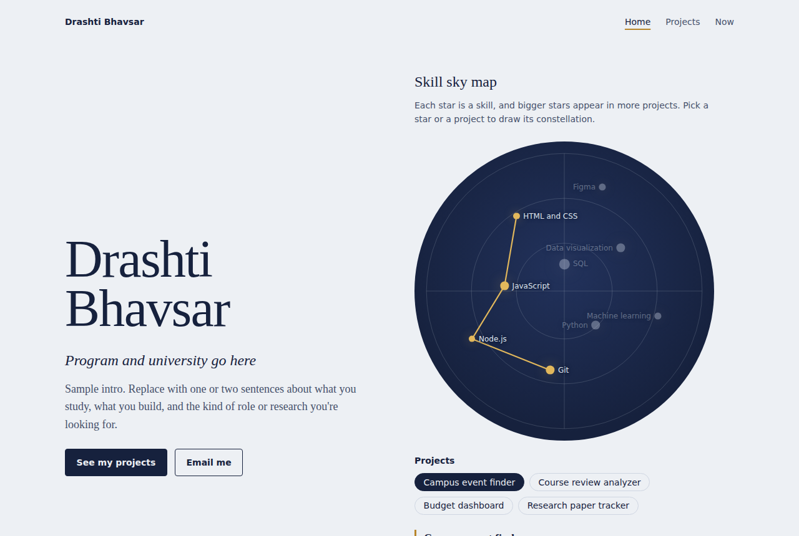

# Drashti Bhavsar: personal homepage

My personal homepage, built with vanilla HTML5, CSS3 and ES6 modules. It has no frameworks, no component libraries and no backend.

- **Author:** Drashti Bhavsar ([GitHub](https://github.com/Drashti0913))
- **Class:** [Web Development](https://northeastern.instructure.com/courses/261032)
- **Live site:** [drashtibhavsar.com](https://drashtibhavsar.com)
- **Demo video:** : [public video link](https://youtu.be/GAaeQRXNaDw)
- **Design document:** [docs/design-document.md](./docs/design-document.md)
- ** Slides:** https://docs.google.com/presentation/d/19sa73-uGT1jtSlqy1ftlFkmx0rzad3mqYDV96R4nFz0/edit?usp=sharing



## Project objective

Build a static homepage that helps recruiters, faculty and classmates understand what I work on and how to reach me, while practicing semantic HTML, organized CSS, and JavaScript split into ES6 modules.

## Pages

| Page | File         | What's on it                                                                            |
| ---- | ------------ | --------------------------------------------------------------------------------------- |
| Home | `index.html` | Everything: hero, about, skills, projects, experience, publications, education, contact |

## Features

- Bold, dark single-page design: hero with a typed rotating headline and crossfading photos, a tech ticker, count-up stats, and sections for about, skills, projects, experience, research, achievements, leadership, education and contact.
- 17 project cards, each linked to its GitHub repo, with a headline metric, a category filter and a pointer-following glow. Featured projects get a wide card.
- Research section with live Google Scholar numbers (citations, h-index, i10-index) and a citation bar for each paper.
- A scroll progress bar and a copy-email button.
- Respects `prefers-reduced-motion`: animations, typing and count-ups turn off.
- Content lives in [`js/data.js`](./js/data.js). A project appears on the site once it has a `code` link. The `profile.resumes` list adds the resume download button (PDF in the repo root).
- SEO: page metadata, Open Graph card, JSON-LD, sitemap and robots.txt.

## Project structure

```text
.
├── index.html            Home page
├── css/style.css         All styles, organized by tokens, base, layout, components, pages
├── js/
│   ├── main.js           Entry module: renders sections, filter, menu
│   ├── data.js           All site content (edit this to update the site)
│   └── render.js         DOM helpers and renderers
├── images/               Favicon, headshot, screenshot
│   └── life/             Web-sized photos for the hero
├── docs/                 Design document and wireframe mockups
├── eslint.config.js      ESLint config
├── .prettierrc           Prettier config
├── package.json
└── LICENSE               MIT
```

## Instructions to build

You need [Node.js](https://nodejs.org/) 18 or newer.

1. Clone the repository and install the dev tools.

```bash
   git clone https://github.com/Drashti0913/Portfolio-DrashtiBhavsar.git
   cd Portfolio-DrashtiBhavsar
   npm install
```

2. Start a local server and open the site. ES modules don't load from `file://`, so use a server.

```bash
   npm start
```

3. Check formatting and linting.

```bash
   npm run format
   npm run lint
```

To update the content, edit `js/data.js`. Each project's `skills` list must use ids from the `skills` list.

## Deployment

The site is deployed with GitHub Pages from the `main` branch (Settings, then Pages, then "Deploy from a branch", then `main` and `/ (root)`).

## Use of generative AI

- **Tool and model:** Claude Opus 5.5 by Anthropic, used through claude.ai, in September 2026.
- **What it was used for:**
  - Converting the content of my earlier Next.js portfolio into a plain HTML, CSS and ES6 module structure that meets the assignment requirements.
  - Drafting the code for the skill sky map and project filter.
  - Generating the `now.html` page, which is the AI-generated page the assignment asks for.
  - Drafting the wireframes, design document and this README.
- **Prompts (summarized):**
  - "Here is the assignment rubric and my current Next.js portfolio. Rebuild it in vanilla HTML, CSS and ES6 modules so it meets every rubric item."
  - "Add an original interactive component that isn't a common portfolio feature."
  - "Write a design document with a project description, user personas, user stories and mockups."
  - "Here are my old Next.js component files. Move my real content from them into data.js."
  - "Show one large photo beside my bio in the About section, and make the Get in touch button scroll to the contact section."
  - "Rewrite any lines Prettier would change so the code passes a Prettier check."
  - (October 2026, Claude Code) "Redesign my portfolio to be eye-catching and enthusiastic, inspired by jaygohil.com, using my GitHub, LinkedIn and Google Scholar." This produced the current visual design, the new sections (research stats, achievements, leadership) and six more project cards.
- **What I reviewed and changed by hand:** I checked every section against my old portfolio and chose which content and photo to use. I changed the About section to a single large photo and adjusted its size, replaced the "Email me" button with "Get in touch" so it works without an email app, and ran all three pages through the W3C validator. I reviewed the generated code before publishing it.

## License

[MIT](./LICENSE)
